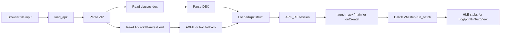

NekoDroid includes a constrained HLE Dalvik runner that can load APKs directly in the browser. This page shows exactly how to run a fixture APK in the web interface, what happens inside the emulator during HLE execution, and how to drive the same flow from JavaScript using the Wasm API.

## What happens during HLE APK execution?

When you run an APK inside NekoDroid, the emulator performs these stages:

1. Scans the ZIP payload for `classes.dex` and optionally `AndroidManifest.xml`.
2. Parses the DEX into a structured format with string/form/prototype/method/class tables.
3. Discovers the entry point, preferring `static main` on the launcher class, falling back to `onCreate`.
4. Steps the register-based Dalvik VM one instruction at a time through the interpreter.
5. Intercepts framework method calls via HLE stubs instead of Android services.
6. Logs text output and, when blitted, draws it into the VRAM framebuffer.

## Run a fixture APK in the browser

These steps assume NekoDroid is loaded in your browser with the debug panel visible.

<Steps>
  <Step title="Load the APK">
    In the APK upload section, click **Load APK**. Select `testdata/hello.apk` from your NekoDroid clone (the fixture built by the in-tree test). The system log shows `APK loaded: hello.apk (821 bytes)`. Files over 32 MiB are rejected with an `APK too large` message.
  </Step>
  <Step title="Check the APK info">
    After loading, the UI calls `get_apk_info()` and logs a JSON object such as:

    ```json
    {"package":"com.nekodroid","activity":"Lcom/nekodroid/Hello;","apk_size":821,"classes":1,"halted":false,"steps":0,"logs":0}
    ```
  </Step>
  <Step title="Run the APK (HLE)">
    Click **Run APK (HLE)**. The web UI performs the equivalent of:

    ```js
    launch_apk();
    const steps = run_dalvik_batch(50_000);
    blit_dalvik_text_to_vram();
    ```

    The render mode auto-switches to VRAM so you can view the blitted output on the emulator screen.
  </Step>
  <Step title="Read the logcat panel">
    The `apk-logcat` control in the debug panel shows HLE output. For the hello fixture, the logs are:

    ```text
    Hello from NekoDroid
    ```

    The arithmetic fixture (`build_arith_dex`, built only inside the test suite) logs `5`. If the panel shows `(no HLE logs)`, the app printed nothing through a stubbed method or halted early.
  </Step>
  <Step title="Interact with touch">
    Click or drag on the canvas to forward touch into the HLE runtime. Touch down and move set `touch_down=true` and update last coordinates; release is deferred by one frame to ensure the VM sees at least one full frame of press.
  </Step>
</Steps>

## What does the internal pipeline look like?

Below is the loading and execution order inside the Rust handler:



The APK loader (`src/android/apk.rs`) iterates the ZIP and looks for `classes.dex` and `AndroidManifest.xml`. If the manifest starts with `#nekodroid-manifest`, a tiny text parser extracts the package and activity; otherwise it best-effort scans binary AXML or falls back to DEX class-table heuristics to guess the package and launcher.

## HLE stubs available during execution

The HLE host (`src/android/hle.rs`) intercepts the following method calls:

| Method call | What NekoDroid does |
| --- | --- |
| `Landroid/util/Log;.*(tag, msg)` | Adds a formatted `[tag] msg` line to the log buffer. |
| `Ljava/io/PrintStream;.println` | Adds the argument string to the log buffer. |
| `Lnekodroid/Hle;.println` | Same as PrintStream (used by fixtures). |
| `Lnekodroid/Hle;.printInt` | Converts the int argument to a string and logs it. |
| `Landroid/widget/TextView;.setText` | Sets `canvas_text` and logs the message. |
| Activity / Object `.<init>` | No-op stub success. |
| `setContentView` / `setTitle` | No-op stub success. |
| `getLastTouchX` / `getLastTouchY` / `isTouchDown` | Returns the last forwarded touch values from the host. |

When the interpreter encounters `invoke-static`, `invoke-virtual`, or similar, it asks `HleHost::try_invoke` whether the target class/name is stubbed. If so, the stub runs immediately and no DEX code is searched or executed. If there is no stub, the interpreter tries to find the encoded method in the DEX file; if that is also absent, the call succeeds silently and returns `Int(0)`, so unknown framework methods never halt the VM.

## Touch forwarding via dalvik_touch

The browser UI forwards mouse/touch events from the canvas to the DVM HLE host:

```js
// Inside src/main.ts (web UI)
canvas.addEventListener('mousedown', (e) => {
  const [x, y] = canvasCoords(e);
  send_touch_event(x, y, true);  // ARM CPU MMIO
  dalvik_touch(x, y, true);      // HLE VM
});
```

Inside `src/lib.rs`:

```rust
#[wasm_bindgen]
pub fn dalvik_touch(x: i32, y: i32, is_down: bool) {
    APK_RT.with(|cell| {
        if let Some(rt) = cell.borrow_mut().as_mut() {
            rt.vm.host.touch_x = x;
            rt.vm.host.touch_y = y;
            rt.vm.host.touch_down = is_down;
        }
    });
}
```

This means HLE touch inspectors inside the APK return the latest forwarded coordinates and state.

## VRAM text blit

After an HLE run, `blit_dalvik_text_to_vram()` takes the current `canvas_text` from the HLE host and draws it into the emulator VRAM using a simple block-glyph renderer at CPU VRAM address `0x04000000`. It fills a dark background and renders each ASCII character as a patterned 8x8 grid. You can switch the render mode to VRAM in the UI to see the blitted text directly on the simulated screen.

## Drive the flow programmatically with the Wasm API

Instead of using the UI buttons, call these Wasm-exported functions from JavaScript.

### `load_apk(apk_bytes: Uint8Array): boolean`

Loads an APK into the HLE Dalvik runtime. Returns `false` if the file exceeds 32 MiB or parsing fails.

```js
const bytes = new Uint8Array(
  await fetch('/hello.apk').then(r => r.arrayBuffer()) // served from public/
);
const ok = load_apk(bytes);
console.assert(ok, 'APK load failed');
```

### `get_apk_info(): string`

Returns a JSON string with package, activity, size, class count, halted state, step count, and log count.

```js
const info = JSON.parse(get_apk_info());
console.log(info.package, info.classes);
```

### `launch_apk(): boolean`

Finds the entry method (`main` or `onCreate`) and pushes the initial VM frame. Returns `false` if no APK is loaded or no entry method is found.

```js
if (!launch_apk()) {
  throw new Error('No valid entry point');
}
```

### `run_dalvik_batch(count: number): number`

Runs at most `count` Dalvik instruction steps and returns the number actually executed. The VM halts when a `return-void` / `return` empties the call stack, or when an unimplemented opcode is hit.

<Warning>
  An unimplemented opcode makes this call return `0`, and the halt reason is not added to the logs. If the web UI reports `HLE Dalvik ran 0 steps`, check `get_apk_info()`: `halted: true` with a small `steps` value means the app used an opcode NekoDroid does not support yet. See [Dalvik Opcodes](/reference/dalvik-opcodes).
</Warning>

```js
const executed = run_dalvik_batch(50_000);
console.log(`Executed ${executed} Dalvik steps`);
```

### `get_dalvik_logs(): string`

Returns all log lines collected by the HLE host, joined by newlines.

```js
const logs = get_dalvik_logs();
if (logs.includes('Hello from NekoDroid')) {
  console.log('Fixture smoke passed');
}
```

### `blit_dalvik_text_to_vram(): boolean`

Draws the current HLE `canvas_text` into VRAM. Returns `true` if text was present and written.

```js
if (blit_dalvik_text_to_vram()) {
  // set render mode to VRAM in the UI to view it
}
```

## Full scripted example

```js
// Copy testdata/hello.apk into public/ first so Vite serves it at /hello.apk
async function runHelloApk() {
  // 1) fetch fixture
  const res = await fetch('/hello.apk');
  const bytes = new Uint8Array(await res.arrayBuffer());

  // 2) load and inspect
  if (!load_apk(bytes)) return;
  const info = JSON.parse(get_apk_info());
  console.log('Loaded:', info.package, info.activity);

  // 3) launch and run
  if (!launch_apk()) return;
  const steps = run_dalvik_batch(50_000);

  // 4) collect output
  const logs = get_dalvik_logs();
  console.log(`steps=${steps} logs=`);
  console.log(logs);

  // 5) blit to screen
  blit_dalvik_text_to_vram();
}
```

<Note>
  NekoDroid's HLE runner is not a full Android OS. It does not run Play Store apps, JNI libraries, or full ART. Only single-DEX APKs that rely on stubbed framework methods are expected to execute cleanly.
</Note>

<CardGroup>
  <Card title="Supported APKs" icon="check" href="/android/supported-apks">
    See which APKs are compatible and what is required.
  </Card>

  <Card title="Build a Test APK" icon="hammer" href="/android/build-test-apk">
    Generate fixture DEX and APK binaries from the Rust source.
  </Card>

  <Card title="CPU Debugger" icon="bug" href="/guides/cpu-debugger">
    Debug the underlying ARM CPU state and registers.
  </Card>
</CardGroup>
