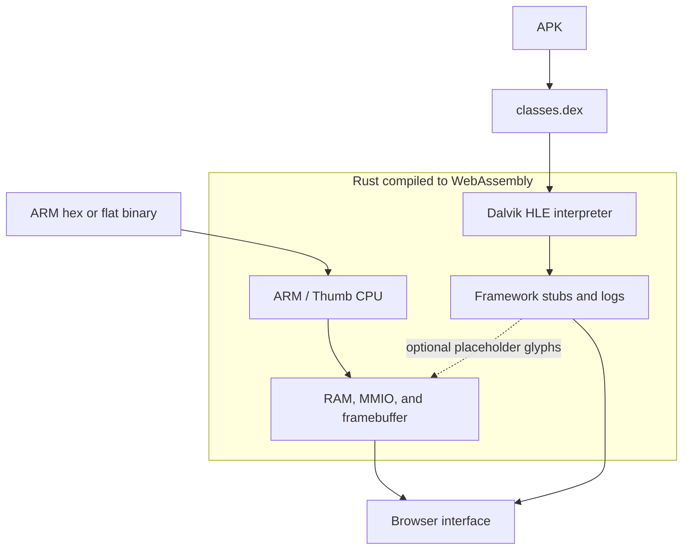

NekoDroid uses one Rust WebAssembly module with two separate runtimes: an ARM emulator for machine code and a Dalvik HLE interpreter for APK bytecode. This page explains their inputs, output, and limitations.

## Execution Paths

APK bytecode does **not** pass through the ARM CPU. Both runtimes are controlled through JavaScript exports from the same WebAssembly module.

## ARM Emulation

Load ARM hex or a flat binary at `0x8000`, then single-step or run an instruction batch. The CPU maintains registers and memory between calls. Memory-mapped peripherals provide framebuffer, keyboard, touch, audio, and UART behavior.

The framebuffer is 800 × 600 RGBA. `init_emulator(0)` selects 512 MiB of RAM; a nonzero argument requests a size in MiB, capped at 4096. Large allocations can exceed a browser's available memory.

The system timer advances at instruction intervals inside `run_batch`, not at a fixed wall-clock rate. See the [memory map](/reference/memory-map) and [peripherals](/reference/peripherals) before writing guest programs.

## APK Emulation

The APK loader extracts `classes.dex` and creates a separate Dalvik session. The interpreter executes a supported subset of opcodes and intercepts selected framework calls, including logging and basic text hooks.

This is high-level emulation, not ART or a full Android OS. Unknown native or framework methods return an integer zero. Unsupported opcodes halt execution. The runtime does not load extra DEX files or JNI libraries.

Logs are readable in the interface. The optional VRAM blit draws placeholder glyph patterns, not a complete Android UI or readable text font. Start with the [Hello APK](/android/run-apk) and review [compatibility limits](/android/supported-apks).

## JavaScript Bridge

The browser calls exports such as `init_emulator`, `run_batch`, `load_apk`, and `run_dalvik_batch`. It reads framebuffer bytes through WebAssembly memory and renders them to a canvas.

The [JavaScript API](/reference/wasm-api) documents the exports and their return values. Its ARM and APK examples use separate initialization flows.

## Experimental Kernel Boot

Linux and Android kernel helpers prepare the ARM CPU's boot state. They do not turn the Dalvik HLE path into a full Android system, and loading a system image does not make additional framework APIs available to HLE APKs.

Use the [kernel boot guide](/guides/boot-linux) for experiments, not as a guarantee of a completed Linux or Android boot.
