NekoDroid maps the entire ARMv7 address space into a flat, byte-addressable layout. This page documents every memory region so you can write bare-metal code, debug the MMU, or target specific peripherals without guessing addresses.

## Address Space Overview

The emulator starts with RAM at the bottom of the 32-bit address space and places memory-mapped I/O (MMIO) at fixed high addresses. The following diagram shows the major regions.

```mermaid
---
title: NekoDroid 32-bit Address Space
---
flowchart LR
    subgraph Low["0x00000000 – Low Memory"]
        RAM["RAM (0–size)"]
    end
    subgraph MMIO1["0x04000000 – Display & Console"]
        VRAM["VRAM 800x600 RGBA"]
        UART["UART / Input / Timer / Audio"]
    end
    subgraph MMIO2["0x0A000000 – Android IPC"]
        BINDER["Binder IPC"]
    end
    subgraph VPB["0x10100000 – VersatilePB"]
        RTC["RTC"]
        VIC["VIC"]
        SP804["SP804 Timer"]
        PL011["PL011 UART"]
    end
    subgraph Android["0x1B000000 – Android MMIO"]
        ASHMEM["ASHMEM"]
        MMC["MMC"]
        PIPE["Goldfish Pipe"]
        ALOG["Android Logger"]
        FB["Goldfish FB"]
    end
    subgraph High["0xFF000000 – High MMIO"]
        GTTY["Goldfish TTY"]
    end
    RAM --> VRAM --> UART --> BINDER --> RTC --> VIC --> SP804 --> PL011 --> ASHMEM --> MMC --> PIPE --> ALOG --> FB --> GTTY
```



<Note>
  Writes to unmapped addresses are silently ignored. Reads from unmapped addresses return `0`.
</Note>

## Region Table

The following table lists every documented region, its base address, size, and purpose.

| Region | Base Address | Size | Purpose |
| --- | --- | --- | --- |
| RAM | `0x00000000` | configurable (default 512 MiB, max 4096 MiB) | Main system memory |
| VRAM | `0x04000000` | 1,920,000 bytes (800 x 600 x 4) | RGBA framebuffer displayed on canvas |
| Misc MMIO | `0x10000000` | 32 bytes | UART, input, timer, and audio registers |
| Binder IPC | `0x0A000000` | 1 MiB | Android Binder driver stub |
| VersatilePB window | `0x10100000` | 1 MiB | Board-specific peripherals |
| Goldfish RTC | `0x10101000` | 4 KiB | Real-time clock |
| PL190 VIC | `0x10140000` | 4 KiB | Vectored Interrupt Controller |
| SP804 Timer | `0x101E2000` | 32 bytes | Dual timer module (Timer1 wired to VIC line 4) |
| PL011 UART0 | `0x101F1000` | 4 KiB | Serial console for Linux earlyprintk |
| ASHMEM | `0x1B000000` | 64 KiB | Anonymous shared memory |
| MMC | `0x1C000000` | 64 KiB | SD/MMC card interface for system images |
| Goldfish Pipe | `0x1D000000` | 1 MiB | Host-guest communication pipe |
| Android Logger | `0x1E000000` | 64 KiB | Logcat interface |
| Goldfish FB | `0x1F000000` | 16 MiB | Android framebuffer config |
| Goldfish TTY | `0xFF002000` | 4 KiB | Goldfish earlyprintk console |

## RAM Configuration

Call `init_emulator(ram_mb)` from JavaScript (or Rust) to set the RAM size before loading a program.

| Parameter | Behavior |
| --- | --- |
| `0` | Uses the default of **512 MiB** |
| `1–1024` | Allocates the requested megabytes |
| `1025–4096` | Allocates but warns that large tabs may OOM in some browsers |
| `> 4096` | Hard-capped to **4096 MiB** |

After initialization the CPU resets with:

| Register | Value |
| --- | --- |
| PC | `0x00008000` |
| SP | `ram_size - 0x10000` |

<Warning>
  The 32 MiB upload soft cap applies to ROMs, kernels, and APKs loaded through the UI.
</Warning>

## VRAM Pixel Format

The framebuffer at `0x04000000` stores pixels in **RGBA8888** (32 bits per pixel) in row-major order.

| Byte Offset | Channel |
| --- | --- |
| +0 | Red |
| +1 | Green |
| +2 | Blue |
| +3 | Alpha (0xFF = opaque) |

Total size: `800 * 600 * 4 = 1,920,000` bytes. The last valid address is `0x041D4BFF`.

Writing to VRAM from C:

```c
#define VRAM_BASE 0x04000000
#define SCREEN_W  800

void put_pixel(int x, int y, unsigned char r, unsigned char g, unsigned char b) {
    volatile unsigned char *vram = (unsigned char *)VRAM_BASE;
    int off = (y * SCREEN_W + x) * 4;
    vram[off + 0] = r;
    vram[off + 1] = g;
    vram[off + 2] = b;
    vram[off + 3] = 0xFF;
}
```

## Next steps

<CardGroup cols={3}>
  <Card title="Peripherals" icon="cpu" href="/reference/peripherals">
    Register-level details for UART, timers, audio, and Android devices.
  </Card>

  <Card title="CPU Debugger" icon="bug" href="/guides/cpu-debugger">
    Step through instructions and inspect registers in the debug panel.
  </Card>

  <Card title="Bare-Metal Programs" icon="code" href="/guides/bare-metal-programs">
    Compile and run your own ARM binaries with custom MMIO access.
  </Card>
</CardGroup>
